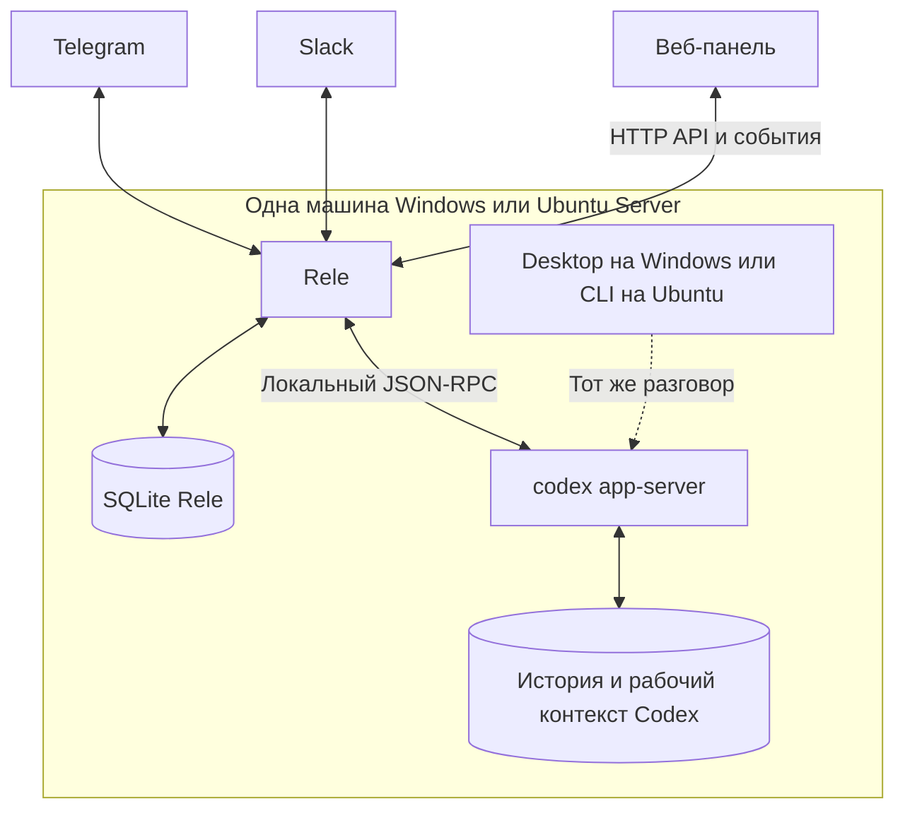

# Архитектура и план релиза Rele

Архитектура Rele, редакция 0.2 от 18 октября 2026 года. Целевой первый выпуск — v0.1.0.

Rele связывает один сохраняемый разговор локального codex app-server с максимум одним разговором Telegram и одним тредом Slack. На Windows этот же разговор открывается в штатном Codex Desktop, на Ubuntu Server — в Codex CLI. История и текущий контекст остаются у Codex. Rele доставляет итоговый ответ только в источник конкретного запроса и показывает связи по названиям.

Первая версия — одна локальная установка Rele рядом с Codex. Windows и Ubuntu Server используют общую кодовую базу. Отдельный Rele Node и распределённое управление машинами отложены; WSL исключён. Первый технический прототип подтверждает совместную работу Rele и штатного Desktop или CLI с одним активным серверным тредом.

# Требования и границы

| Требование | Решение |
| --- | --- |
| Windows | Rele, Codex Desktop и app-server на одном ПК; нативный запуск |
| Ubuntu Server | Rele, Codex CLI и app-server на одном сервере без графической среды |
| Один контекст разговора | Один канонический тред в конкретном локальном runtime Codex |
| Общая история в штатном клиенте | Desktop на Windows или CLI на Ubuntu продолжает тот же разговор |
| Ответы в мессенджерах | Ответ возвращается только в источник своего запроса |
| Связи по названиям | Заголовки разговоров, каналы и проекты в интерфейсе; устойчивые идентификаторы внутри |
| Состав приложения | Один процесс Rele с веб-панелью, адаптерами, очередью и SQLite |
| Голосовые сообщения | Локальное распознавание перед передачей текста в Codex |
| Секреты | Локальное хранение; авторизация Codex остаётся в его профиле |

Первый профиль эксплуатации — личная установка с явно разрешёнными авторами сообщений. Привязанные каналы относятся к одному доверенному контексту: ответ из любого из них может использовать сведения, поступившие через остальные.

Telegram в базовом проектировании подключается через Bot API: диалог с ботом или доступная боту группа и тема. Доступ к существующим личным перепискам пользовательского аккаунта потребует отдельного адаптера. [Область доступа Telegram-ботов](https://core.telegram.org/bots/faq).

# Технологическая основа

| Слой | Базовый выбор | Причина |
| --- | --- | --- |
| Язык | TypeScript | Общие типы сервера и интерфейса |
| Исполнение | Node.js 24 LTS | Единая среда для интеграций на обеих ОС |
| HTTP API | Fastify | Небольшой сервер для панели и управляющих запросов |
| Панель | React и Vite | Браузерный интерфейс, доступный и для Ubuntu Server |
| Хранилище | SQLite и SQL-миграции | Локальные транзакции для связок, очереди и доставки |
| Обновления панели | SSE | Состояния выполнения и доставки поступают в браузер |
| Связь с Codex | Локальный адаптер JSON-RPC app-server | Зависимость от протокола Codex ограничена одним модулем |
| Проверки | Vitest и Playwright, CI на Windows и Ubuntu | Общие проверки логики, интеграций и веб-панели |

Это выбранный стек Rele. Node.js рекомендует LTS для эксплуатации; на дату архитектуры ветка 24 имеет статус LTS. [Политика релизов Node.js](https://nodejs.org/en/about/previous-releases).

SQLite является архитектурным выбором; конкретный драйвер и его бинарные зависимости фиксируются в сборке и проверяются на обеих ОС. Наличие встроенного модуля само по себе не служит основанием считать его API стабильным.

Сервер Rele раздаёт собранную веб-панель. Браузер выступает интерфейсом управления, поэтому отдельная нативная графическая оболочка для первой версии не требуется.

# Компоненты и связи

Один процесс Rele принимает сообщения, хранит связи, управляет очередью и доставкой, обслуживает панель. Он является единственным активным получателем событий каждой подключённой установки Slack или Telegram.

Встроенный адаптер Codex обнаруживает или подключает выбранный локальный runtime, читает названия тредов, запускает ходы и получает события. Соответствие запросов и запусков хранится в той же SQLite базе Rele. Codex app-server и штатный Desktop или CLI остаются отдельными процессами.

Codex владеет историей, текущим выполнением, рабочим контекстом, инструментами и своей политикой подтверждений.

Пунктирная связь обозначает условие совместимости: штатный клиент и Rele должны работать с одной активной серверной сущностью разговора. CLI документирует подключение к app-server через локальный сокет или WebSocket. Способ подключения установленного Windows Desktop, обновление истории и согласование одновременного ввода подтверждаются прототипом. [Codex CLI](https://learn.chatgpt.com/docs/cli/reference), [App-server](https://learn.chatgpt.com/docs/app-server).

# Владение разговором и идентичность

Разговор однозначно определяется локальной установкой, профилем владельца Codex и серверным thread ID. В первой версии выбирается один локальный runtime; он может обслуживать много разговоров. Отдельный серверный процесс на каждый тред не требуется.

Название связки, проект и заголовок разговора используются для поиска и отображения. Переименование не меняет привязку. Например, пользователь выбирает проект «Rele» и разговор «Архитектура шлюза».

Desktop на Windows и CLI на Ubuntu должны продолжать тот же серверный разговор. Отдельный независимый Codex-тред для синхронизации сообщений не создаётся.

Два независимых app-server, использующих общую папку истории, не являются принятой схемой совместной работы: общий файл сам по себе не координирует память процессов, активный ход, подписки и запросы подтверждения. Это инженерное ограничение выбранной архитектуры.

Разговор закрепляется за локальным runtime. Отдельные установки Rele имеют собственные связи и состояние. Перенос разговора между Windows и Ubuntu и управление несколькими машинами не входят в первый релиз.

# Развёртывание на одной машине

| Вариант | Размещение | Управление |
| --- | --- | --- |
| Windows | Rele, SQLite, app-server и Desktop на одном ПК | Браузер на этом ПК; автозапуск Rele при входе пользователя |
| Ubuntu Server | Rele, SQLite, app-server и CLI на одном сервере | Терминал по SSH; веб-панель в браузере другого ПК через SSH-туннель |

Windows и Ubuntu Server — два варианта установки одной программы. Если нужны обе установки одновременно, они используют раздельные подключения к мессенджерам: один и тот же бот или установка Slack не обслуживается двумя независимыми Rele.

Веб-панель слушает локальный адрес. Для Ubuntu Server базовый способ доступа — SSH-туннель с рабочего ПК. Графическая среда на сервере не требуется.

Slack получает события через Socket Mode; Telegram — через long polling. Получение сообщений такими способами можно организовать без публичного входящего HTTP endpoint. [Slack Socket Mode](https://docs.slack.dev/apis/events-api/using-socket-mode/), [Telegram updates](https://core.telegram.org/bots/faq).

Остановка Rele не должна завершать app-server, принадлежащий Desktop или общей пользовательской службе. Владелец процесса Codex, правила его запуска и восстановления фиксируются после первого прототипа. При недоступности Codex Rele сохраняет новые запросы в очереди.

# Особенности Windows и Ubuntu Server

| Область | Windows | Ubuntu Server |
| --- | --- | --- |
| Среда Rele | Нативный процесс Windows | Нативный процесс Linux без графической среды |
| Штатный клиент | Codex Desktop на том же ПК | Codex CLI на том же сервере |
| Учётная запись | Пользователь установленного Desktop и нужного профиля Codex | Пользователь, которому принадлежат профиль Codex и проекты |
| Автозапуск | Task Scheduler при входе пользователя | systemd service с явно заданной учётной записью |
| Доступ к панели | Локальный браузер | Браузер рабочего ПК через SSH-туннель |
| Проверки ОС | Пути с пробелами и кириллицей, пользовательский профиль, Desktop | Права файлов, CLI, запуск после перезагрузки и выход из SSH |

Для связи с существующими Desktop-чатами профиль ОС является частью архитектуры. Задача Windows запускается в контексте указанной учётной записи; сервисный аккаунт не следует автоматически приравнивать к пользователю Desktop. [Контексты Task Scheduler](https://learn.microsoft.com/en-us/windows/win32/taskschd/security-contexts-for-running-tasks).

На Ubuntu Server Rele запускается службой systemd под выбранным пользователем. Интерактивный CLI для общего разговора использует согласованный профиль и точку подключения к тому же app-server. Служба должна продолжать работу после завершения SSH-сессии и запускаться после перезагрузки.

WSL не используется для разработки целевого сценария, исполнения Rele или релизной проверки Windows. Ubuntu Desktop и удалённый Desktop для Ubuntu Server исключены из текущего объёма.

Целевая матрица первого выпуска — Windows 11 x64 и Ubuntu Server 24.04 LTS x64. Ubuntu Server 26.04 LTS включается в дополнительную проверку совместимости. Поддерживаемые версии ОС и Codex указываются в релизе по результатам фактических прогонов.

# Данные и сохранность

| Сущность | Содержание |
| --- | --- |
| Settings | Локальная точка подключения Codex, профиль, версия, ссылки на секреты |
| Conversation | Имя связки, server thread ID, проект, состояние |
| Binding | Площадка, установка или аккаунт, чат, тред или тема, разрешённые авторы |
| Request | Исходное событие, источник, автор, адрес возврата, очередь, состояние |
| Turn | Соответствие request ID и серверного turn ID, состояние выполнения |
| Outbox | Подготовленный ответ, адрес назначения, статус доставки и внешний message ID |

Ограничения уникальности обеспечивают максимум одну привязку каждой площадки к разговору и не позволяют один внешний тред незаметно направить в два разных контекста.

Rele хранит SQLite на локальном диске. В этой базе находятся очередь, соответствие запросов ходам Codex и журнал доставки. Полная рабочая история остаётся у Codex; Rele сохраняет содержимое ответов в объёме, необходимом для доставки и восстановления.

SQLite WAL используется локально, с короткими транзакциями и настройками сохранности, выбранными для очереди. WAL не предназначен для совместного доступа к одной базе с разных машин через сетевой диск. [SQLite WAL](https://www.sqlite.org/wal.html).

Резервное копирование охватывает отдельно базу Rele, локальное состояние Codex и рабочие файлы. Одной копии базы связок недостаточно для восстановления контекста. Активную SQLite базу копируют согласованным способом с учётом WAL; файлы с токенами и ключами имеют отдельные правила восстановления.

# Обработка сообщения

1. Адаптер получает событие и определяет источник, автора и адрес ответа.

2. Rele транзакционно сохраняет входящее событие и проверяет его уникальность.

3. После сохранения подтверждает приём площадке и помещает запрос в очередь связки.

4. Выбирает локальный серверный тред и передаёт встроенному адаптеру устойчивый request ID.

5. Адаптер фиксирует начало отправки и запускает ход в существующем серверном треде.

6. Полученный turn ID связывается с request ID и адресом ответа.

7. События обновляют состояние в панели.

8. Итоговый ответ сохраняется в Outbox.

9. Отдельная операция доставки отправляет его в исходный внешний тред и записывает результат.

Цепочка происхождения неизменяема: внешнее событие → request ID → server turn ID → адрес ответа. Маршрут определяется кодом Rele; модель формирует содержимое ответа.

Запросы, созданные напрямую в Desktop или CLI, остаются в общей серверной истории. Rele не публикует их ответы в Telegram или Slack, если у запуска нет соответствующего внешнего запроса.

В базовой версии в мессенджер отправляются итог, требуемые подтверждения и сообщения об ошибках; подробный ход выполнения отображается в панели. Длинный ответ делится на части с сохранением порядка. Голосовое сообщение распознаётся локально до постановки текста на выполнение; ошибка распознавания возвращается инициатору.

# Очередь и восстановление

Одна очередь Rele соответствует одному каноническому треду. Следующий обычный запрос должен выполняться после предыдущего и использовать его результаты.

Прямой ввод из Desktop или CLI требует совместной координации: либо штатный сервер надёжно сериализует изменения, либо все изменяющие запросы проходят через общий управляемый вход, поддерживаемый клиентом. Подписка на события и проверка статуса перед запуском сами по себе не устраняют гонку.

Steer первоначально ограничивается явным уточнением текущего хода его инициатором. Запрос из другого мессенджера не должен незаметно сливаться с чужим выполняющимся ходом или менять адрес его ответа.

| Ситуация | Требуемое поведение |
| --- | --- |
| Повтор внешнего события | Повторный запрос не создаётся |
| Второе сообщение в занятый тред | Становится следующим запросом |
| Codex недоступен | Rele сохраняет очередь и показывает недоступность |
| Ответ Codex готов, площадка недоступна | Повторяется доставка ответа, задача не запускается заново |
| Потерян ответ на команду запуска | Выполняется сверка с сервером; неоднозначность требует проверки |
| Потеряно подтверждение отправки в мессенджер | Доставка отмечается как неопределённая; возможный дубль не скрывается |
| Перезапуск Rele или Codex | Состояние восстанавливается из базы и сверяется с Codex |
| Событие от самого бота | Не запускает ответ по циклу |
| Прерывание или запрос подтверждения | Относится к конкретному turn и его инициатору |

Если сервер мог принять запрос до обрыва, автоматический повтор его исполнения блокируется до сверки. Это особенно важно для задач, изменяющих файлы и внешние системы.

Внешние API и app-server не следует считать одной распределённой транзакцией. Архитектура обеспечивает дедупликацию известных событий и явную обработку неопределённости; абсолютная однократность всех внешних действий не обещается.

# Доступ и секреты

Панель слушает loopback и защищает управляющие операции аутентификацией и проверкой происхождения запросов. Для доступа с другого ПК используется SSH-туннель. Секреты и служебные точки подключения доступны только выбранному пользователю и процессам приложения.

У каждой внешней привязки есть разрешённые авторы. Связки, рабочие каталоги и политика запуска изменяются через авторизованный управляющий интерфейс. Rele сохраняет действующие ограничения и подтверждения Codex.

| Среда | Хранение секретов Rele |
| --- | --- |
| Windows | DPAPI в области пользователя или поддерживаемое системное хранилище |
| Ubuntu Server | Локальные credential files с правами владельца либо systemd credentials |

DPAPI обычно связывает защищённые данные с учётной записью и машиной. Восстановление Windows-установки учитывает эту зависимость. [DPAPI](https://learn.microsoft.com/en-us/windows/win32/api/dpapi/nf-dpapi-cryptprotectdata).

Rele хранит локальные токены своих подключений Slack и Telegram. Codex использует авторизацию своего профиля и штатные механизмы входа. Подключение Rele к уже авторизованному runtime не требует сбора токенов Codex в отдельном центре.

В журнал по умолчанию попадают технические состояния и идентификаторы доставки. Токены исключаются; сохранение полных текстов и срок хранения вложений задаются явно.

# Веб-панель

Главный раздел — «Связки». Каждая строка содержит понятное название, проект, разговор Codex, Telegram, Slack, текущее состояние выполнения и состояние доставки. На Windows показывается доступ к этому разговору в Desktop; на Ubuntu — предусмотренный способ продолжения в CLI.

Связка создаётся выбором доступного локального Codex-треда по названию и внешних разговоров. Ручной ввод технических ID не входит в обычный сценарий. Telegram показывает только известные доступные боту разговоры; в Slack различаются рабочее пространство, канал и тред.

Остальные разделы:

- «Codex» — локальное подключение, версия, профиль и результат проверки совместимости.

- «Очередь» — ожидающие и выполняющиеся запросы с обозначением источника.

- «Доставка» — готовые, отправленные, ошибочные и неопределённые ответы.

- «Подключения» — Slack, Telegram и параметры доступа.

Статус отражает отдельно выполнение и доставку: например, «Codex завершил, ответ ещё не отправлен». Названия обновляются без изменения устойчивой связи. При совпадениях показываются организация, проект и профиль.

# Сборки и проверка совместимости

Один репозиторий содержит ядро Rele, адаптеры Slack и Telegram, интеграцию Codex, хранение, платформенные функции и веб-панель. Они работают внутри одного приложения. Отдельный сервис Rele Node и протокол управления удалёнными машинами не разрабатываются.

Дистрибутивы Windows и Ubuntu Server собираются из одних исходников. Runtime и нативные зависимости фиксируются. Настройки и миграции данных имеют явные версии; совместимость адаптера Codex проверяется для указанной версии app-server.

Общие проверки запускаются в CI на Windows и Ubuntu с начала разработки. Отдельно проверяются установленный Windows Desktop и интерактивный CLI на Ubuntu Server с настоящим app-server. Имитация сервера в тестах не подтверждает совместимость штатных клиентов.

Релизная матрица включает запуск и автозапуск, имена и пути с кириллицей и пробелами, сохранность очереди после перезапуска, переподключение к Codex, корректность доставки и браузерные сценарии панели.

Команда app-server в официальной документации имеет статус Experimental. Совместимая версия Codex фиксируется; обновление проходит контрактные проверки и общий сценарий со штатным Desktop или CLI. [Статусы и параметры команд Codex](https://learn.chatgpt.com/docs/cli/reference).

# План действий до первого релиза

| Этап | Работа | Условие завершения |
| --- | --- | --- |
| 1 Репозиторий и проверка Codex | Зафиксировать требования и план, настроить минимальный проект и CI двух ОС; проверить общий runtime на Windows и Ubuntu Server | Rele и штатный Desktop или CLI продолжают один разговор, наблюдают один ход и согласованно обрабатывают одновременный ввод |
| 2 Локальное ядро | Конфигурация, адаптер Codex, SQLite, связки, постоянная очередь, корреляция запросов и очередь ответов | Связки сохраняются; запрос связан с конкретным turn и неизменяемым адресом ответа; доступен небольшой сквозной локальный сценарий |
| 3 Telegram и Slack | Сначала Telegram Bot API, затем Slack Socket Mode; текст, авторы, ответы, подтверждения и ошибки | Обе площадки используют общий контекст и получают только свои ответы; повтор событий и ответы бота не создают новых задач |
| 4 Веб-панель | Подключения, выбор разговоров по названиям, создание и пауза связки, очередь, доставка и диагностика Codex | Связка создаётся без копирования ID; одинаковые названия различимы; панель показывает фактическое состояние |
| 5 Надёжность и голосовые | Сбои запуска и доставки, перезапуски, прямой ввод Desktop или CLI, локальное распознавание аудио | Задачи не повторяются вслепую после неопределённого запуска; голос преобразуется в текст перед выполнением; ошибки возвращаются инициатору |
| 6 Установка и эксплуатация | Готовые пакеты Windows и Ubuntu, автозапуск, хранение секретов, обновление, резервная копия и инструкция | Чистая установка и перезагрузка проходят на целевых ОС; обновление и восстановление сохраняют связки и корректное состояние очереди |
| 7 Кандидат и выпуск | Собрать v0.1.0-rc.1, пройти реальные сценарии, исправить блокирующие дефекты, собрать v0.1.0 | Пройдены критерии релиза; конкретному коммиту соответствуют проверенные пакеты, описание изменений и тег |

Работа начинается с небольшого репозитория и доказательства общего runtime. Windows получает первый реальный тест Desktop. Общая сборка и проверки Windows и Ubuntu запускаются с начала проекта; основная реализация опирается на подтверждённый способ подключения.

Критерии первого этапа:

- На Windows Desktop и Rele действительно работают с одной активной серверной сущностью разговора; на Ubuntu Server это подтверждено для CLI и Rele.

- Сообщения из Rele видны в истории штатного клиента, а последующее продолжение в нём учитывает эти обмены.

- Одновременный ввод не создаёт потерянных запросов, не меняет источник ответа и не запускает конфликтующие ходы.

- При обрыве в момент запуска система не повторяет потенциально уже выполненную задачу без сверки.

- Соединение и доступ к профилю работают под ожидаемым пользователем.

Если штатный клиент не предоставляет необходимого совместного доступа, результат первого этапа — воспроизводимое описание ограничения и конкретные варианты решения. Изменение сценария работы согласуется до основной реализации. Запуск независимых сессий и копирование текста между ними не считаются выполнением требования общего разговора.

# Критерии первого релиза

Rele v0.1.0 — устанавливаемое приложение для Windows и Ubuntu Server с браузерной панелью, локальным Codex, обоими мессенджерами и сохранением состояния. Готовность оценивается по пользовательским сценариям и фактической проверке поставляемых пакетов.

Зафиксированы общий серверный контекст, адресная доставка ответа, именованные привязки, единственный владелец выполнения, сохранение очередей и явное восстановление неопределённых операций.

Релиз включает проверенный общий разговор со штатным Desktop на Windows и CLI на Ubuntu Server. Наличие зелёных тестов общего ядра само по себе не закрывает эту интеграцию.

# Приёмочные сценарии

| Сценарий | Ожидаемый результат |
| --- | --- |
| Windows Desktop → Telegram → Slack | Общий контекст; Desktop показывает все обмены; каждый внешний ответ приходит только в свой тред |
| Ubuntu CLI → Telegram → Slack | Продолжается тот же локальный разговор; скрытый второй исполнитель не создаётся |
| Telegram и Slack пишут одновременно | Оба запроса сохраняются, порядок определён, адреса ответов не смешиваются |
| Desktop или CLI пишет во время внешней задачи | Действует проверенное согласование выполнения; внешний ответ сохраняет своего адресата |
| Переименование или совпадение названий | Связь остаётся корректной; пользователь различает проекты, каналы и разговоры |
| Повтор события и сообщение самого бота | Повторного выполнения и цикла ответов нет |
| Сбой после принятия команды Codex | Выполнение сверяется; задача с неизвестным результатом не запускается автоматически повторно |
| Ответ готов, площадка недоступна | Сохраняется ответ и повторяется доставка без нового запуска Codex |
| Сбой после отправки ответа до сохранения подтверждения | Неопределённая доставка отображается и обрабатывается явно |
| Подтверждение действия, ошибка или отмена | Состояние относится к правильному запросу и инициатору |
| Голосовое сообщение | Локальное распознавание даёт текст для того же треда; ошибка распознавания не запускает задачу |
| Перезагрузка, обновление, восстановление | Связки, очередь и история сохраняют согласованность |

# Поставка и работа с репозиторием

Пользователь создаёт репозиторий Rele и предоставляет URL и доступ на запись. Начальные материалы — README, требования и архитектура в docs/ARCHITECTURE.md, этапы и текущий статус в docs/PLAN.md. После переноса в репозиторий эти файлы становятся рабочим источником требований и плана.

Разработка идёт законченными небольшими изменениями с проверками и фиксацией результата. Обычные решения по коду, исправления и проверки выполняются самостоятельно; пользователь подключается при изменении согласованного поведения, необходимости доступа или недоступной проверке на его машине.

Результат выпуска — проверенные пакеты для Windows и Ubuntu Server, инструкция установки и автозапуска, настройка подключений, описание резервного копирования и обновления, перечень поддерживаемых версий Codex, release notes и тег v0.1.0. Для первой поставки достаточно готовых архивов со скриптами запуска и установки службы; исходники не требуется собирать на машине пользователя. Требуемые версии Node.js и Codex указываются явно.

Автоматизированные проверки, сборка и выпуск связываются с одним коммитом. После проверки кандидата изменения создают нового кандидата либо проходят необходимые повторные проверки; в стабильный выпуск не попадает непроверенный код.

# Доступ для самостоятельного завершения

| Что требуется | Для чего |
| --- | --- |
| Репозиторий с доступом на запись и CI | Код, ветки и PR, проверки, сборки и материалы релиза |
| Windows с установленным и авторизованным Desktop | Доказательство общего runtime и финальная проверка штатного клиента |
| Ubuntu Server с авторизованным Codex CLI | Проверка headless-установки, общего разговора, службы и восстановления |
| Тестовые Telegram и Slack | Настоящие входящие события, ответы и подтверждения в разрешённых чатах |
| Локально настроенные секреты | Авторизация интеграций без включения токенов в исходники или переписку |

Код, тесты, исправления, документацию и сборки можно провести в доступной рабочей среде. При доступе к тестовым машинам и репозиторию там же выполняются реальные прогоны и выпуск в пределах предоставленных прав. Если прямого доступа к Windows нет, для владельца готовится короткий сценарий запуска и сбор результатов; до его прохождения совместимость Desktop остаётся открытым критерием релиза.

