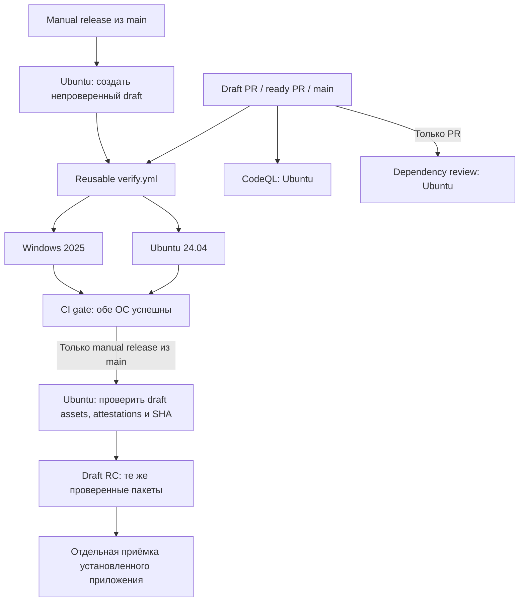

# CI Rele

Оркестрация находится в [ci.yml](../.github/workflows/ci.yml), общая Windows/Linux
матрица — в reusable [verify.yml](../.github/workflows/verify.yml). Отдельные
workflows выполняют [CodeQL](../.github/workflows/codeql.yml) и
[dependency review](../.github/workflows/dependency-review.yml). Репозиторий `rele`
публичный; public guard оставляет все эти jobs выключенными при private visibility.
Релизные переходы, разрешение публикации и отдельные RC/stable gates —
[RELEASING](RELEASING.md); ниже описана реализованная автоматизация.

| Режим | Runner-ы на событие | Что выполняется |
|---|---|---|
| Draft PR | 2 matrix + 1 CodeQL + 1 dependency review; затем CI gate на Ubuntu | npm ci, типы, контракт CI, unit, build, Chromium E2E, production UI/API smoke; независимые security checks |
| Ready PR | те же, до 4 одновременно | Всё выше + сборка пакетов, установка/удаление, protocol и managed для всех поддерживаемых версий Codex, native Goal lifecycle на последней поддерживаемой версии, CPU voice |
| `main` | 2 matrix + 1 CodeQL; затем CI gate на Ubuntu | Полный набор проверок и CodeQL |
| Ручной dispatch с `release: false` | 2 matrix, затем CI gate на Ubuntu | Полный набор без передачи пакетов и публикации |
| Windows, полный режим | Windows matrix job | Заблокированные файлы при cleanup, Desktop backend, owner/pipe, installer/native shared под обычным пользователем |
| Linux, полный режим | Ubuntu matrix job | Debian/systemd lifecycle, native shared/recovery, voice с запрещёнными network syscalls |
| Ручной release из main | 1 Ubuntu подготовки → 2 matrix → CI gate → 1 Ubuntu финализации | Непроверенный draft → полный набор → attestation и прямая загрузка пакетов в draft → проверка скачанных assets/attestations/SHA/commit/run → проверенный draft без пересборки |
| CodeQL по расписанию | 1 Ubuntu | Еженедельный анализ JavaScript/TypeScript и Python |

В одной matrix одновременно работают максимум два runner-а. Независимые security
workflows могут работать параллельно с ней; общего ограничения «два runner-а на
репозиторий» нет. События разных PR и запуск по расписанию также могут пересекаться.
CodeQL не загружает database artifact и не использует dependency cache. Dependency
review отклоняет добавленные уязвимые зависимости уровня moderate и выше;
Dependabot отдельно открывает еженедельные PR для npm и GitHub Actions.

`CI gate` завершается ошибкой, если хотя бы одна ОС выбранной matrix не прошла;
невыбранный release/обычный caller обязан быть `skipped`. Он не агрегирует CodeQL
и dependency review. Активный ruleset защищает `main` от удаления и force-push,
требует разрешения review threads и успешный `CI gate` от GitHub Actions на
актуальной ветке (проверено 2026-11-12). Security workflows добавлены; включение их
в required checks после интеграции отслеживается в issue #8.

Версии Codex берутся из `SUPPORTED_CODEX_VERSIONS`, отдельного списка в YAML нет.
Фикстуры используют изолированные профили и подменённый model endpoint; реальные
модели, ключи Slack/Telegram и пользовательские профили для CI не нужны.
В полном режиме `native_controls` запускает `tests/native-source-controls.test.ts`
с native бинарником последнего элемента `SUPPORTED_CODEX_VERSIONS`, уже
установленного fixture-шагом. Отдельный профиль и loopback provider проверяют
создание, pause, restart, продолжение и завершение Goal без платного inference.
Обычный unit-прогон с пропущенным env-gated тестом этот обязательный gate не заменяет.
Успех mocked UI/protocol не доказывает доставку реального сообщения или Windows
GUI/DPAPI в сессии владельца: эти проверки остаются в приёмке RC.

## TDD через PR

1. Описать наблюдаемый дефект и критерий приёмки в issue.
2. Открыть draft PR с регрессионным тестом, получить RED на обеих ОС. В PR указать
   ссылки на run и assertion: ошибка установки или импорта не считается RED.
3. Добавить исправление, получить GREEN того же теста и остальных быстрых проверок.
4. После GREEN перевести PR в ready: полный набор запускается на обеих ОС.
   Draft `Fast (...)` не заменяет полный набор.

RED и GREEN — отдельные push/run на двух матричных runner-ах; постоянно работающий
runner не нужен. Для диагностики можно запускать тот же тест локально, но hosted
результаты привязаны к точному SHA PR.

## Выпуск и бесплатные лимиты

Обычные PR/main и ручной dispatch с `release: false` не создают Release и не
загружают пакеты. Кэш и Actions artifacts не используются ни в одном режиме.
Пакеты передаются через assets конечного draft Release; отдельного временного
Actions storage, quota approval или последующего удаления transfers нет.

Ручной `release: true` разрешён только из public `main`. Подготовительный Ubuntu
job проверяет текущий SHA, новый `X.Y.Z-rc.N` и отсутствие занятого git-тега или
Release, включая drafts. Он создаёт непроверенный draft с pinned SHA/run/attempt
и передаёт его ID двум OS jobs. Это ещё не готовый RC: до финализации в названии
и описании явно указана незавершённая проверка.

Каждая ОС после всех своих обязательных проверок формирует комплект из двух
пакетов, двух `.sha256` и `evidence.json`. Сохраняется локальный предел 100 MiB
на комплект. Build job подписывает точные файлы `ci-bundle/*` через GitHub artifact
attestations; дополнительная storage record отключена. Затем он проверяет ID,
флаги, source/run/attempt draft и текущий `main`, прямо загружает свои файлы и
сверяет имя, размер и digest ответа API. Метаданные загружаются с уникальным именем
`linux-evidence.json` или `windows-evidence.json`; их байты остаются неизменными.

После успеха обеих ОС и `CI gate` финальный Ubuntu job скачивает ровно десять
ожидаемых assets этого draft. Метаданные сохраняются обратно как локальные
`incoming/<platform>/evidence.json` с теми же байтами. Для каждого файла
`gh attestation verify` проверяет repository, signer workflow `verify.yml`, source
SHA, `refs/heads/main` и запрет self-hosted runners. Затем проверяются полный
inventory, размеры, SHA256, контрольные файлы и соответствие обоих отчётов этому
SHA/run/attempt. Перед финальными записями повторно проверяются draft и `main`.
Финализатор один раз добавляет сводный `verification.json`, обновляет описание и
повторно читает итоговые флаги и inventory. Пакеты повторно не загружаются и не
пересобираются. Итог содержит одиннадцать assets; Release остаётся
`draft=true, prerelease=true`. Новый сводный JSON сам не является attested build
artifact, его исходные OS-отчёты проверены отдельно.

Обычный reusable caller имеет только `contents: read` и `actions: read`.
Только release caller получает `contents: write`, `id-token: write` и
`attestations: write`; право загрузки assets действует в доверенных build jobs
из `main`. Подготовитель имеет `contents: write`, финализатор — `contents: write`
и `attestations: read`. Используется штатный `GITHUB_TOKEN`, отдельные credentials
или billing-доступ не нужны. Actions artifact storage не является предусловием
этого процесса.

Занятые версии, свои уже существующие assets, неверные флаги, другой SHA/run/attempt,
смена `main` или неподтверждённые байты останавливают следующий шаг. Запись с тем же
именем не заменяется. Частичный результат или потерянный ACK оставляет draft для
сверки: автоматического retry, clobber, удаления draft/assets или повторной
публикации нет. Повторный attempt не может присвоить draft предыдущего attempt.
После неудачи нужно выяснить фактический результат; новая версия не снимает
неопределённость прежней операции.

Hosted runs исполняют Windows Desktop fixture и standard-user canary; ограничения
времени для каждой ОС задаются в `timeout-minutes` workflow. Каждый результат
относится только к своему SHA; `in_progress`, `skipped` или failure не доказывают
успешный обязательный gate. CI не заменяет acceptance установленного пакета;
release dispatch не разрешает публикацию stable или раскатку.
