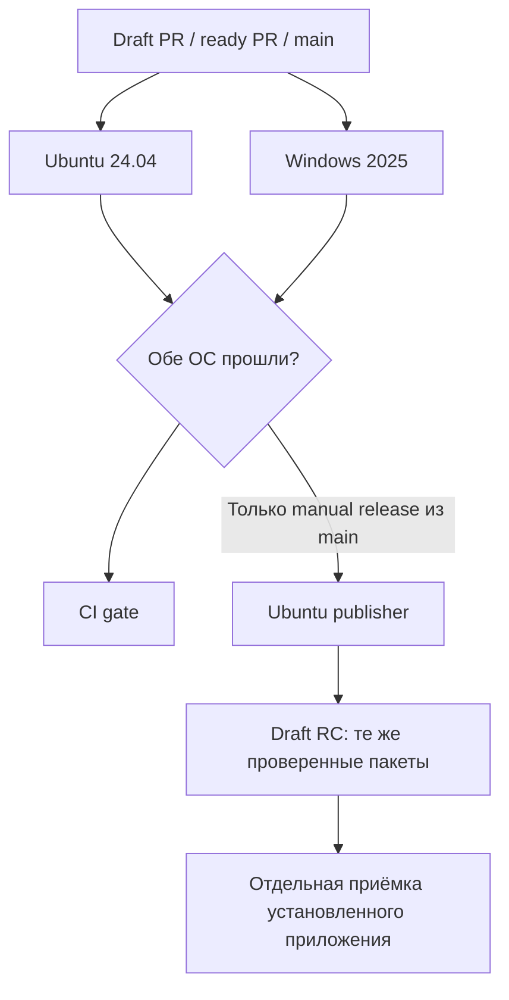

# CI Rele

Конфигурация реализована в `.github/workflows/ci.yml`. Репозиторий `rele` публичный;
GitHub Actions запускает автоматические проверки для PR и `main`. Public guard
оставляет jobs выключенными, если visibility репозитория изменится на private.
Релизные переходы, разрешение публикации и отдельные RC/stable gates —
[RELEASING](RELEASING.md); ниже описана реализованная автоматизация.



| Режим | Runner-ы | Что выполняется |
|---|---|---|
| Draft PR | 2 одновременно, затем CI gate на Ubuntu | npm ci, типы, контракт CI, unit, build, Chromium E2E, production UI/API smoke |
| Ready PR, `main`, ручной dispatch с `release: false` | те же 2, затем CI gate на Ubuntu | Всё выше + сборка пакетов, установка/удаление, protocol и managed для всех поддерживаемых версий Codex, CPU voice |
| Windows, полный режим | Windows job | Заблокированные файлы при cleanup, Desktop backend, owner/pipe, installer/native shared под обычным пользователем |
| Linux, полный режим | Ubuntu job | Debian/systemd lifecycle, native shared/recovery, voice с запрещёнными network syscalls |
| Ручной release из main | 2, затем CI gate и publisher на Ubuntu | Проверки → временные пакеты → сверка SHA/commit/run → draft release без пересборки |

`CI gate` — единый check workflow после matrix; он завершается ошибкой, если
хотя бы одна ОС не прошла. Сейчас активный ruleset защищает `main` от удаления и
force-push, требует разрешения review threads и успешный `CI gate` от GitHub
Actions на актуальной ветке. Остальные security checks и provenance отслеживаются
в issue #8. Gate выполняется
последовательно, поэтому одновременно работают максимум два runner-а.

Версии Codex берутся из `SUPPORTED_CODEX_VERSIONS`, отдельного списка в YAML нет.
Фикстуры используют изолированные профили и подменённый model endpoint; реальные
модели, ключи Slack/Telegram и пользовательские профили для CI не нужны.
Успех mocked UI/protocol не доказывает доставку реального сообщения или Windows
GUI/DPAPI в сессии владельца: эти проверки остаются в приёмке RC.

## TDD через PR

1. Описать наблюдаемый дефект и критерий приёмки в issue.
2. Открыть draft PR с регрессионным тестом, получить RED на обеих ОС. В PR указать
   ссылки на run и assertion: ошибка установки или импорта не считается RED.
3. Добавить исправление, получить GREEN того же теста и остальных быстрых проверок.
4. После GREEN перевести PR в ready: полный набор запускается на обеих ОС.
   Draft `Fast (...)` не заменяет полный набор.

RED и GREEN — отдельные push/run на двух матричных runner-ах; постоянно работающий
runner не нужен. Для диагностики можно запускать тот же тест локально, но hosted
результаты привязаны к точному SHA PR.

## Выпуск и бесплатные лимиты

Обычные PR/main и ручной dispatch с `release: false` не загружают workflow
artifacts. Ручной `release: true` разрешён только из `main`; он запускает полный
набор проверок и publisher. Перед выпуском версия package.json должна быть новым `X.Y.Z-rc.N`:
существующий tag/release никогда не перезаписывается. Publisher перепроверяет,
что main не изменился, и принимает ровно два комплекта текущего run/attempt.

Каждый комплект ограничен 100 MiB; резервируется 200 MiB. Retention — один день,
кэш отключён. После подтверждения SHA-256 всех файлов draft release удаляются
только два transfer-artifact этого запуска. При частичной ошибке draft остаётся
для разбирательства; нельзя вслепую повторять выпуск или удалять старые данные.

Загрузка закрыта по умолчанию. После проверки **account-wide** остатка storage
(включая Packages и другие репозитории) и нулевого бюджета с запретом платного
превышения оператор задаёт repository variable `CI_STORAGE_APPROVAL`:

```json
{"checkedAt":"<текущее UTC-время ISO 8601>","freeBytes":262144000,"paidUsageBlocked":true}
```

Это операторское подтверждение, а не автоматически прочитанный billing status.
Оно действует шесть часов. Дополнительно API проверяет, что текущие artifacts
репозитория вместе с резервом укладываются в консервативные 500 MiB. При отсутствии
подтверждения, недостатке квоты или ошибке API upload не выполняется. Не выдавать
подтверждение при параллельных потребителях, способных исчерпать резерв; нулевой
бюджет аккаунта остаётся обязательной защитой от платы. Накопленное ранее usage
не обнуляется удалением файлов. Старый backup/Actions retention не меняется этим PR.

Hosted runs исполняют Windows Desktop fixture и standard-user canary; ограничения
времени для каждой ОС задаются в `timeout-minutes` workflow. Каждый результат относится только к своему SHA; run
в статусе `in_progress`, `skipped` или с failure не доказывает успешный gate.
CI не заменяет acceptance установленного пакета, а release dispatch не является
разрешением на stable или раскатку.
