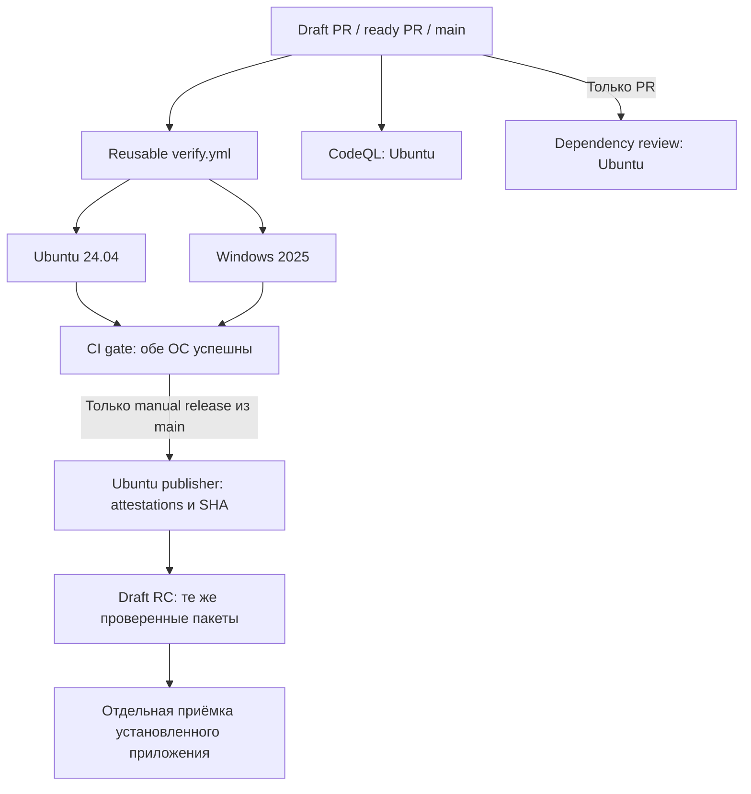

# CI Rele

Оркестрация находится в [ci.yml](../.github/workflows/ci.yml), общая Windows/Linux
матрица — в reusable [verify.yml](../.github/workflows/verify.yml). Отдельные
workflows выполняют [CodeQL](../.github/workflows/codeql.yml) и
[dependency review](../.github/workflows/dependency-review.yml). Репозиторий `rele`
публичный; public guard оставляет все эти jobs выключенными при private visibility.
Релизные переходы, разрешение публикации и отдельные RC/stable gates —
[RELEASING](RELEASING.md); ниже описана реализованная автоматизация.



| Режим | Runner-ы на событие | Что выполняется |
|---|---|---|
| Draft PR | 2 matrix + 1 CodeQL + 1 dependency review; затем CI gate на Ubuntu | npm ci, типы, контракт CI, unit, build, Chromium E2E, production UI/API smoke; независимые security checks |
| Ready PR | те же, до 4 одновременно | Всё выше + сборка пакетов, установка/удаление, protocol и managed для всех поддерживаемых версий Codex, CPU voice |
| `main` | 2 matrix + 1 CodeQL; затем CI gate на Ubuntu | Полный набор проверок и CodeQL |
| Ручной dispatch с `release: false` | 2 matrix, затем CI gate на Ubuntu | Полный набор без передачи пакетов и публикации |
| Windows, полный режим | Windows matrix job | Заблокированные файлы при cleanup, Desktop backend, owner/pipe, installer/native shared под обычным пользователем |
| Linux, полный режим | Ubuntu matrix job | Debian/systemd lifecycle, native shared/recovery, voice с запрещёнными network syscalls |
| Ручной release из main | 2 matrix, затем CI gate, затем publisher на Ubuntu | Полный набор → attestation пакетов → временная передача → проверка attestations/SHA/commit/run → draft release без пересборки |
| CodeQL по расписанию | 1 Ubuntu | Еженедельный анализ JavaScript/TypeScript и Python |

В одной matrix одновременно работают максимум два runner-а. Независимые security
workflows могут работать параллельно с ней; общего ограничения «два runner-а на
репозиторий» нет. События разных PR и запуск по расписанию также могут пересекаться.
CodeQL не загружает database artifact и не использует dependency cache. Dependency
review отклоняет добавленные уязвимые зависимости уровня moderate и выше;
Dependabot отдельно открывает еженедельные PR для npm и GitHub Actions.

`CI gate` завершается ошибкой, если хотя бы одна ОС выбранной matrix не прошла;
невыбранный release/обычный caller обязан быть `skipped`. Он не агрегирует CodeQL
и dependency review. Активный ruleset защищает `main` от удаления и force-push,
требует разрешения review threads и успешный `CI gate` от GitHub Actions на
актуальной ветке (проверено 2026-11-12). Security workflows добавлены; включение их
в required checks после интеграции отслеживается в issue #8.

Версии Codex берутся из `SUPPORTED_CODEX_VERSIONS`, отдельного списка в YAML нет.
Фикстуры используют изолированные профили и подменённый model endpoint; реальные
модели, ключи Slack/Telegram и пользовательские профили для CI не нужны.
Успех mocked UI/protocol не доказывает доставку реального сообщения или Windows
GUI/DPAPI в сессии владельца: эти проверки остаются в приёмке RC.

## TDD через PR

1. Описать наблюдаемый дефект и критерий приёмки в issue.
2. Открыть draft PR с регрессионным тестом, получить RED на обеих ОС. В PR указать
   ссылки на run и assertion: ошибка установки или импорта не считается RED.
3. Добавить исправление, получить GREEN того же теста и остальных быстрых проверок.
4. После GREEN перевести PR в ready: полный набор запускается на обеих ОС.
   Draft `Fast (...)` не заменяет полный набор.

RED и GREEN — отдельные push/run на двух матричных runner-ах; постоянно работающий
runner не нужен. Для диагностики можно запускать тот же тест локально, но hosted
результаты привязаны к точному SHA PR.

## Выпуск и бесплатные лимиты

Обычные PR/main и ручной dispatch с `release: false` не загружают workflow
artifacts. Ручной `release: true` разрешён только из `main`; он запускает полный
набор проверок и publisher. Перед выпуском версия package.json должна быть новым `X.Y.Z-rc.N`:
существующий tag/release никогда не перезаписывается. Publisher перепроверяет,
что main не изменился, и принимает ровно два комплекта текущего run/attempt.

Обычный caller имеет только `contents: read` и `actions: read`. Только release
caller получает `id-token: write` и `attestations: write`: после полного набора
проверок исходный build job подписывает точные файлы `ci-bundle/*`, включая свой
`evidence.json`, через GitHub artifact attestations. Дополнительная storage record
для этих attestations отключена. До создания draft publisher проверяет каждый
полученный файл через `gh attestation verify`: repository, signer workflow
`verify.yml`, source SHA, `refs/heads/main` и запрет self-hosted runners. Затем
существующие guards сверяют полный inventory, размеры, SHA256 и run/attempt.
Publisher имеет права записи contents/actions и чтения attestations; обычные PR
не получают эти права. `verification.json` в Release объединяет два проверенных
`evidence.json`; это отчёт о байтах, а не отдельная attestation этого нового JSON.

Каждый комплект ограничен 100 MiB; резервируется 200 MiB. Retention — один день,
кэш отключён. После подтверждения SHA-256 всех файлов draft release удаляются
только два transfer-artifact этого запуска. При частичной ошибке draft остаётся
для разбирательства; нельзя вслепую повторять выпуск или удалять старые данные.

Загрузка закрыта по умолчанию. После проверки **account-wide** остатка storage
(включая Packages и другие репозитории) и нулевого бюджета с запретом платного
превышения владелец задаёт repository variable `CI_STORAGE_APPROVAL`:

```json
{"checkedAt":"<текущее UTC-время ISO 8601>","freeBytes":262144000,"paidUsageBlocked":true}
```

Это явное подтверждение владельца, а не автоматически прочитанный billing status.
Оно действует шесть часов. Дополнительно API проверяет, что текущие artifacts
репозитория вместе с резервом укладываются в консервативные 500 MiB. При отсутствии
подтверждения, недостатке квоты или ошибке API upload не выполняется. Не выдавать
подтверждение при параллельных потребителях, способных исчерпать резерв; нулевой
бюджет аккаунта остаётся обязательной защитой от платы. Накопленное ранее usage
не обнуляется удалением файлов. Старый backup/Actions retention не меняется этим PR.

Hosted runs исполняют Windows Desktop fixture и standard-user canary; ограничения
времени для каждой ОС задаются в `timeout-minutes` workflow. Каждый результат относится только к своему SHA; run
в статусе `in_progress`, `skipped` или с failure не доказывает успешный gate.
CI не заменяет acceptance установленного пакета, а release dispatch не является
разрешением на stable или раскатку.
