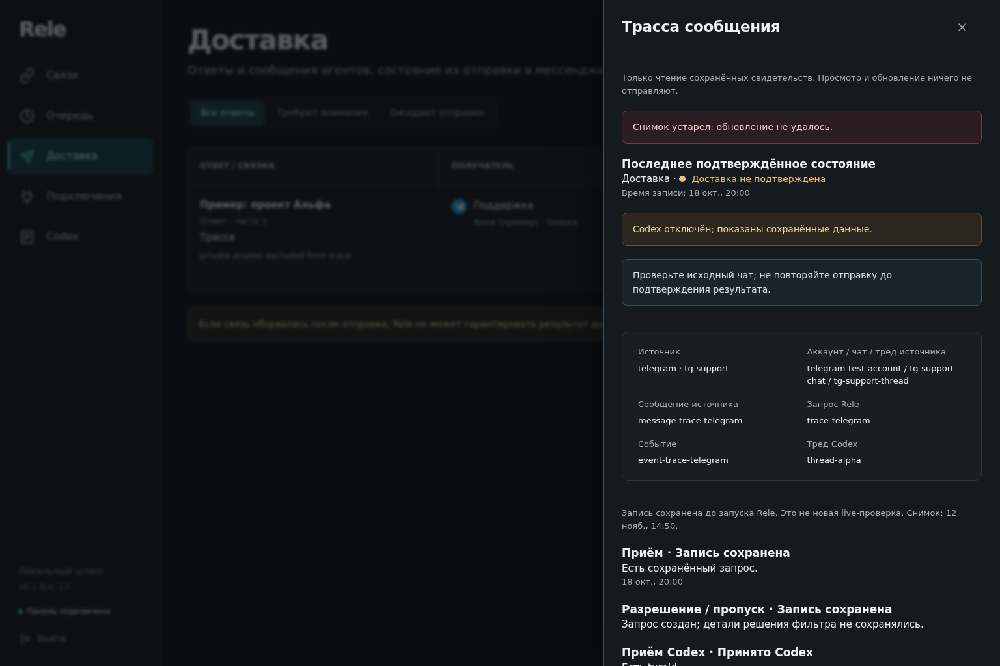
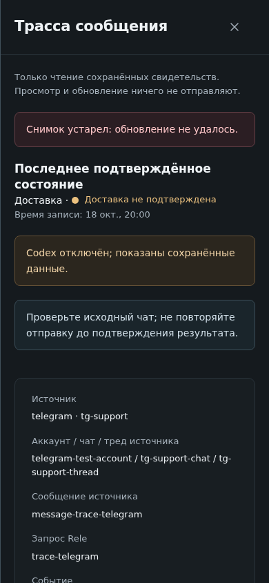

# Synthetic message trace evidence

Captured on 2026-11-12 with application/test bytes from source
`17804ecc8c0166a9e8e48ca7ac925e1903b8e65d`, version `0.1.1-rc.20`.
The screenshots use fictional account, chat, thread and request identifiers;
there is no live messenger, private conversation or installed RC in this fixture.

Method: [message-trace.spec.ts](../../../tests/e2e/message-trace.spec.ts), included
in the local 81/81 passing browser suite. Node 24.22.1, Playwright 1.64.1 and the
explicitly selected local Chromium 1254 executable; hosted CI installs its own
browser. Screenshots show the viewport; the card content continues by scrolling.

| Criterion | Expected | Observed |
| --- | --- | --- |
| Request and delivery identity | Same exact-origin trace; no second-source data | PASS: fixture assertions |
| Refresh failure | Keep the previous snapshot and label it stale | PASS: red stale-snapshot banner |
| Disconnected Codex | Saved evidence is not shown as a fresh native read | PASS: explicit disconnected warning |
| Uncertain delivery | No delivered claim or blind-retry recommendation | PASS: unconfirmed delivery and source-check guidance |
| Desktop/mobile | Readable card without horizontal viewport overflow | PASS: browser assertions and inspected screenshots |
| Read-only access | Trace refresh sends no mutation | PASS: fixture request assertions |

Real Slack/Telegram delivery, owner-session DPAPI and installed-package acceptance
are UNRUN here. See the [data map](../../MESSAGE-TRACE.md) for what each field proves.
