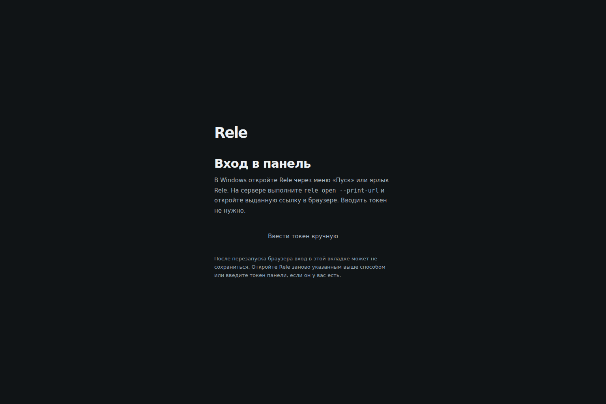
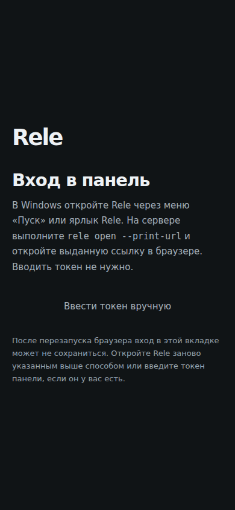
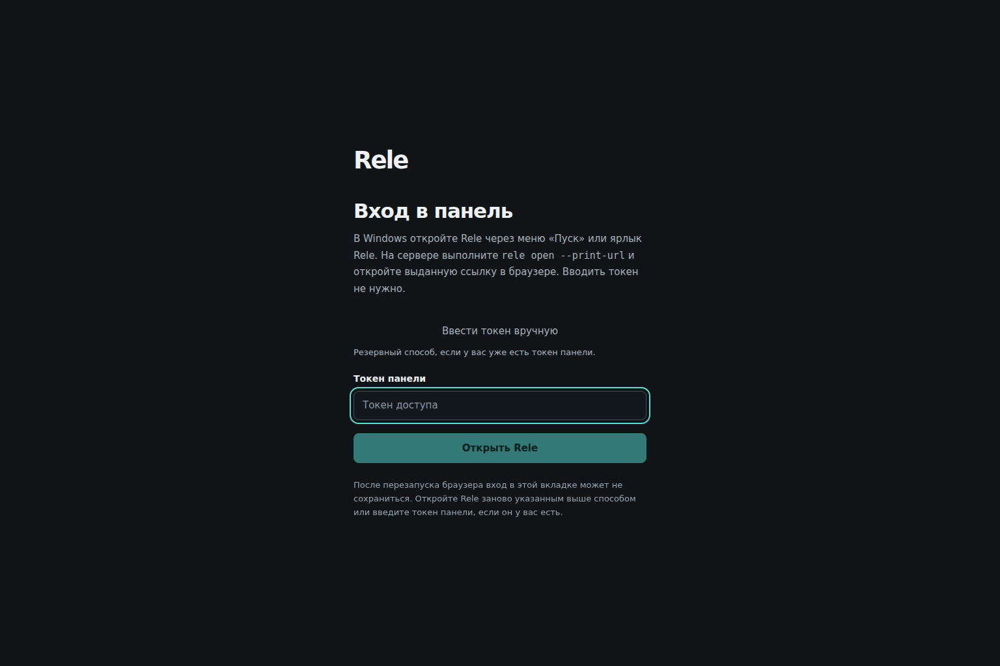
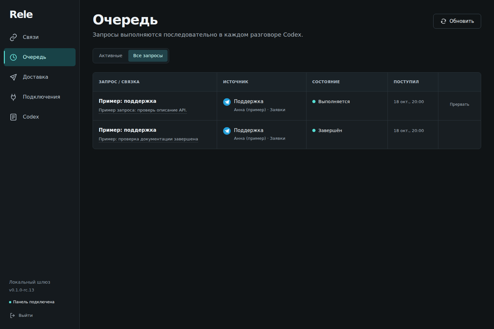

# Panel validation for issues #4 and #5

Source: `1eee2e6ba29e14d073b441fbf2d4b52bc1d983d9`, byte-identical to the
reviewed/tested worker tree `c6474bef6a189ab47927d508777b13a5ba30fab8` before
these evidence files were added. Screenshots use a synthetic intercepted API,
Chromium 1254, desktop 1536×1024 and mobile viewport 390×844. Names, messages
and the version label are fixture data, not an installed RC or a physical phone.

| Criterion | Verification | Result |
|---|---|---|
| #4 launcher-first, manual entry secondary | Keyboard opt-in, focus/labels, screenshots below | PASS |
| #4 one-time link / StrictMode / logout | One exchange; refresh and logout never replay | PASS |
| #4 expired/invalid/network/401 | Recovery guidance and retained error across form toggles | PASS |
| #4 privacy | Clean auth fragment; no token query/log changes; security regression suite | PASS in fixture |
| #5 five sections | Direct URL, reload, active navigation and title | PASS |
| #5 queue Active/All | `?view=queue&queue=all`; no other filters serialized | PASS |
| #5 Back/Forward, rapid/repeated navigation | No extra history entries on data refresh; late data cannot change section | PASS |
| #5 invalid URL / auth / logout | Safe default, retained safe destination, stopped polling after logout | PASS |
| Source checks | Vitest 1809 passed /24 skipped; E2E80/80; typecheck/build/diff; independent review | PASS locally |
| Hosted TDD | RED/GREEN for both issues on Windows and Ubuntu | PASS; runs linked in PR #15 |
| Installed Windows/Linux RC and physical mobile | Separate acceptance | UNRUN |

## Launcher-first sign-in

## Queue restored from URL with All selected

